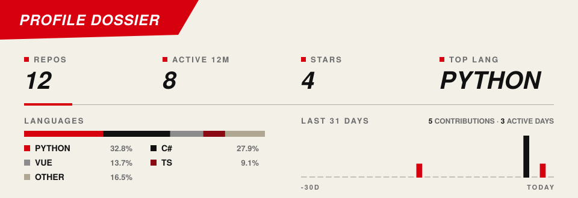

<picture>
  <source media="(prefers-color-scheme: dark)" srcset="./assets/p5/header-dark.svg" />
  
</picture>

## About

软件工程在读，方向是 **模型、视觉与 Agent 工具链**。

## Stack

`Python` · `Java` · `C / C++` · `JavaScript / Vue` · `Linux` · `Git`

## Dossier

<picture>
  <source media="(prefers-color-scheme: dark)" srcset="./assets/p5/dashboard-dark.svg" />
  
</picture>

## Contact

[xiaohj1230@foxmail.com](mailto:xiaohj1230@foxmail.com) · [h2ro.cn](https://h2ro.cn)
